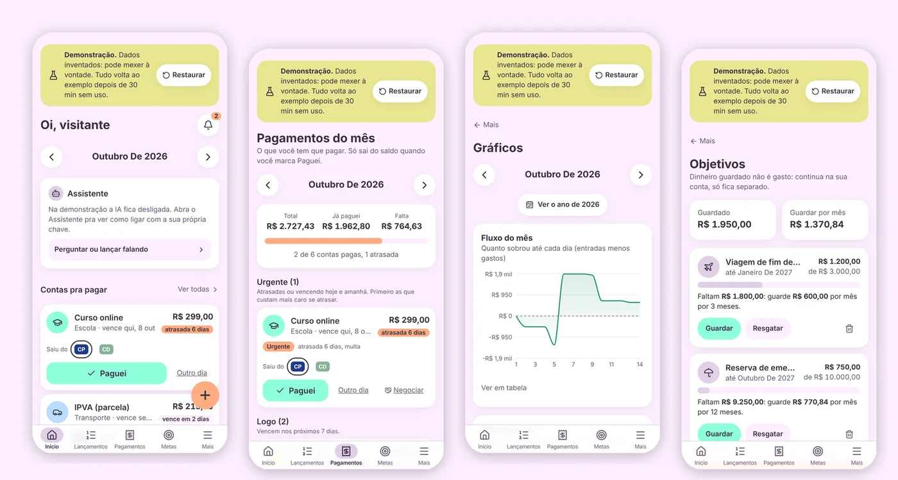
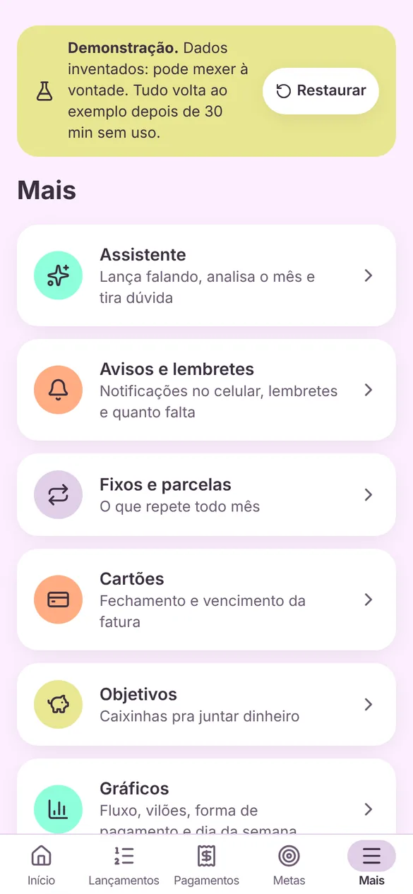
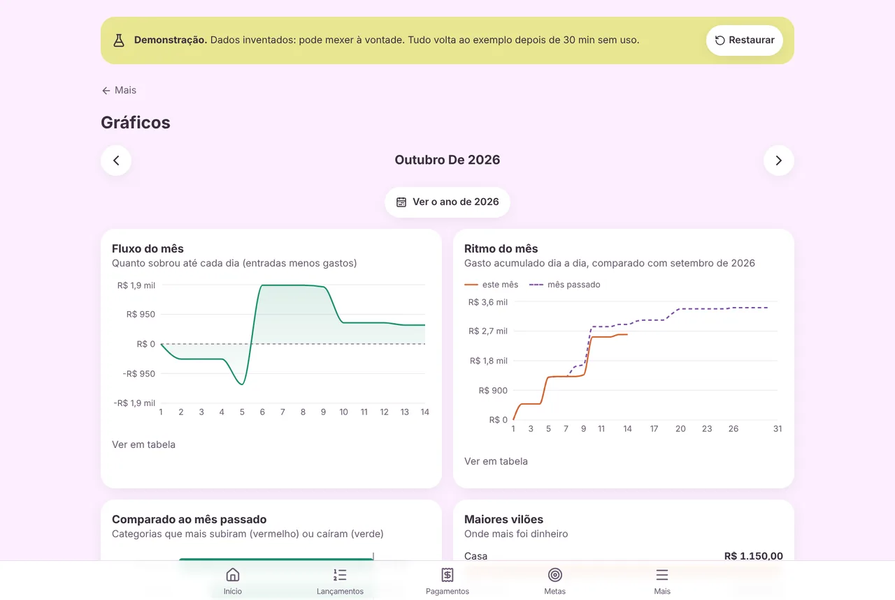
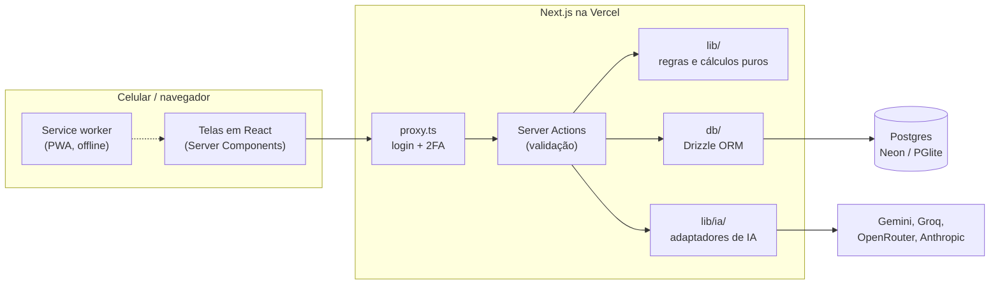

<div align="center">


# ContaGasto

**Controle de gastos pessoal, feito pra usar no celular todo dia.**

Lançar um gasto leva menos de 5 segundos. O app mostra quanto dá pra gastar até o fim do mês, o que ainda vai cair e onde o dinheiro está indo.




</div>

---

## Sumário

- [Por que eu fiz](#por-que-eu-fiz)
- [O que ele faz](#o-que-ele-faz)
- [Telas](#telas)
- [Testar agora (modo demonstração)](#testar-agora-modo-demonstração)
- [Rodar no seu computador](#rodar-no-seu-computador)
- [Como foi construído](#como-foi-construído)
- [Decisões que deram trabalho](#decisões-que-deram-trabalho)
- [Documentação completa](#documentação-completa)
- [Próximos passos](#próximos-passos)

---

## Por que eu fiz

Eu sempre desisti das planilhas de gasto. Elas dizem quanto eu tenho, mas não dizem **quanto eu posso gastar**. Ter R$ 2.000 na conta com aluguel, parcela do celular e fatura do cartão ainda pra cair não é ter R$ 2.000 livres.

O ContaGasto nasceu pra responder isso de um jeito honesto: ele nunca infla o saldo. Empréstimo não vira renda, dinheiro guardado pra um objetivo sai do disponível, e compra no cartão entra no mês em que a fatura vence, que é quando o dinheiro sai de verdade.

Uso ele todo dia desde a versão 1.0.

## O que ele faz

| | |
| --- | --- |
| **Lançar rápido** | Gasto ou entrada em poucos toques, com categoria por ícone, forma de pagamento e banco já marcados. |
| **Disponível até o fim do mês** | Dinheiro nos bancos menos o que falta pagar e o que está guardado. Mostra quanto dá por dia e por semana. |
| **Linha do tempo** | O que já saiu, o que vai cair nos próximos dias e como o mês fecha. |
| **Cartão pela fatura** | Compra no crédito entra no vencimento da fatura certa, respeitando o dia de fechamento. |
| **Fixos e parcelas** | Aluguel, internet, salário no 5º dia útil, compra em 10x. Viram lançamento sozinhos quando a data chega, sem duplicar. |
| **Contas que mudam de valor** | Luz e água entram como estimativa (média dos últimos meses) até você confirmar o valor real. |
| **Pagamentos** | Contas do mês agrupadas por urgência (cartão e aluguel pesam mais que assinatura), com "Paguei" a um toque e opção de negociar. |
| **Metas e objetivos** | Teto de gasto por categoria e caixinhas pra juntar dinheiro com "quanto guardar por mês". |
| **Empréstimos** | Quem te deve e a quem você deve, sem misturar com renda. |
| **Gráficos e resumo do ano** | Fluxo do mês, maiores gastos, mapa de calor, dia da semana, mês a mês. |
| **Avisos** | Conta vencendo, meta estourando, dia de receber, lembretes. Notificação no celular (Web Push). |
| **Assistente com IA** | "Gastei 32 no almoço" vira lançamento pra você conferir. Analisa o mês e responde dúvidas. O app calcula, a IA só explica. |
| **Importar e exportar** | Importa extrato convertido sem duplicar, exporta Excel, relatório em PDF e backup completo. |
| **Segurança** | Senha com hash, sessão assinada, autenticador obrigatório (2FA) e trava contra força bruta. |
| **Instala como app** | PWA com modo escuro, funciona offline pra consultar o que já foi visto. |

## Telas

Todas as imagens são do [modo demonstração](#testar-agora-modo-demonstração), com dados inventados.

### Início

O painel do mês: contas pra pagar, dinheiro nos bancos, quanto dá pra gastar e a linha do tempo.

<p>
  
  
  
  
</p>

### Lançamentos e pagamentos

<p>
  
  
  
  
</p>

### Planejamento

<p>
  
  
  
  
</p>

### Análise

<p>
  
  
  
  
</p>

### Ferramentas

<p>
  
  
  
  
</p>

### No computador



> Quer ver cada tela explicada? Está no [manual de uso](docs/MANUAL.md).

## Testar agora (modo demonstração)

O ContaGasto tem um **modo demonstração** feito pra portfólio:

- abre sem login, já com 4 meses de dados inventados;
- o banco vive só na memória do servidor, então **não existe dado real pra vazar**, nem se alguém configurar um banco de verdade por engano;
- dá pra mexer em tudo: lançar, pagar, apagar. Os dados voltam ao exemplo depois de 30 minutos sem uso ou no botão **Restaurar**;
- login, área de desenvolvedor, restaurar backup, notificações e IA ficam desligados.

```bash
npm install
BOLSO_DEMO=1 npm run dev
```

Abra `http://localhost:3000`. Pra publicar a demonstração na Vercel, veja [docs/INSTALACAO.md](docs/INSTALACAO.md#publicar-a-demonstração).

## Rodar no seu computador

Precisa de Node.js 20 ou mais novo. Não precisa instalar banco: no computador o app usa um Postgres embutido ([PGlite](https://pglite.dev)) salvo na pasta `.data`.

```bash
git clone <url-deste-repositório> bolso
cd bolso
npm install
npm run db:setup   # cria as tabelas e as categorias
npm run dev        # http://localhost:3000
```

No computador o app abre direto, sem senha. Pra ligar o Assistente com a sua chave de IA (tem opção grátis), siga [docs/IA.md](docs/IA.md). Deploy na Vercel com Neon está em [docs/INSTALACAO.md](docs/INSTALACAO.md).

| Comando | O que faz |
| --- | --- |
| `npm run dev` | Servidor de desenvolvimento |
| `npm test` | Roda os 419 testes (Vitest) |
| `npm run lint` | ESLint |
| `npm run build` | Build de produção |
| `npm run db:migrate` | Aplica as migrations (local ou Neon) |
| `npm run db:seed` | Cria categorias e formas de pagamento |
| `npm run db:studio` | Abre o Drizzle Studio pra olhar o banco |

## Como foi construído



- **Next.js 16 (App Router) + React 19 + TypeScript.** Quase tudo é Server Component; o formulário grava por Server Actions. Pouco JavaScript vai pro celular.
- **Regras de dinheiro em funções puras** (`src/lib`), sem banco e sem tela, cobertas por testes. A tela só mostra o que o cálculo devolve.
- **Postgres com Drizzle ORM.** Neon na nuvem, PGlite (Postgres em WebAssembly) no computador e na demonstração. 16 migrations versionadas.
- **Dinheiro sempre em centavos inteiros.** Nada de float.
- **Tailwind 4 sem biblioteca de componentes**, com tokens de cor validados pra contraste (WCAG AA) nos dois temas.
- **IA trocável por variável de ambiente**: um formato neutro de conversa e dois adaptadores (SDK da Anthropic e formato da OpenAI, que serve pro Gemini, Groq, OpenRouter e outros).

Detalhes em [docs/ARQUITETURA.md](docs/ARQUITETURA.md).

### Estrutura

```
src/
├── app/            telas (uma pasta por rota) e Server Actions
├── components/     componentes de interface
├── lib/            regras de negócio e cálculos (puros, testados)
│   └── ia/         assistente: provedores, ferramentas e formato neutro
├── db/             schema, consultas, gerador de recorrências, demonstração
└── proxy.ts        porteiro: login, autenticador e modo demonstração
drizzle/            migrations SQL
scripts/            migrar, seed, gerar ícones
docs/               manual, regras, arquitetura, segurança, IA, instalação
```

## Decisões que deram trabalho

Algumas coisas parecem simples e não são. Estas foram as que mais pensei:

- **Cartão de crédito.** O gasto entra na data em que a fatura vence, não no dia da compra. Compra até o dia de fechamento entra na fatura do mês; depois, na próxima. Parcela N cai N−1 faturas depois. Dia 31 em fevereiro vira dia 28 sem pular fatura.
- **Recorrência sem duplicar.** Abrir o app dez vezes no mesmo dia não pode gerar o aluguel dez vezes. Cada lançamento gerado tem uma competência (ano e mês) e o banco tem índice único por recorrência e competência.
- **Dia útil de verdade.** "Salário no 5º dia útil" conta segunda a sábado e pula feriados nacionais, incluindo a Sexta-feira Santa (calculada a partir da Páscoa).
- **O que é dinheiro livre.** Vale alimentação tem saldo próprio e fica fora do saldo; empréstimo não é renda; dinheiro guardado em objetivo continua no banco mas sai do disponível.
- **IA que não inventa número.** O assistente não faz conta. Ele chama ferramentas que devolvem os valores já calculados pelo app e nada é salvo sem o toque da pessoa.
- **Demonstração sem risco.** O modo demo ignora qualquer banco configurado e monta um Postgres na memória com dados que dependem da data de hoje, então a demo está sempre "no mês atual".

As regras completas estão em [docs/REGRAS-DE-NEGOCIO.md](docs/REGRAS-DE-NEGOCIO.md).

## Documentação completa

| Documento | Conteúdo |
| --- | --- |
| [Manual de uso](docs/MANUAL.md) | Cada tela, passo a passo, com imagens |
| [Regras de negócio](docs/REGRAS-DE-NEGOCIO.md) | Como o app conta: cartão, fixos, disponível, empréstimos, VA |
| [Arquitetura](docs/ARQUITETURA.md) | Stack, pastas, banco de dados, fluxo de uma requisição, design |
| [Segurança](docs/SEGURANCA.md) | Login, 2FA, sessão, o que a demonstração bloqueia, limites conhecidos |
| [Assistente com IA](docs/IA.md) | Como funciona e como ligar com a sua chave |
| [Instalação e deploy](docs/INSTALACAO.md) | Rodar local, Vercel + Neon, publicar a demonstração |
| [Roadmap](docs/ROADMAP.md) | O que vem na 2.0 |
| [Histórico de versões](CHANGELOG.md) | Tudo que mudou desde a 1.0 |

## Próximos passos

A 1.x é pra uma pessoa só. A 2.0 vai abrir pra outras pessoas, e por isso a prioridade é privacidade: dados guardados no aparelho e sincronizados com criptografia de ponta a ponta, extrato lido no próprio celular, e uma IA que só recebe números agregados. O plano está em [docs/ROADMAP.md](docs/ROADMAP.md).

---

<div align="center">

Feito por **[Vinícius Gonçalves](https://github.com/Viniciusp2)** · Engenharia de Software (UEPA) · Belém, Pará

<a href="https://www.linkedin.com/in/vin%C3%ADcius-gon%C3%A7alves-28b994149/"></a>
<a href="mailto:viniciusgvhrj@gmail.com"></a>
<a href="https://github.com/Viniciusp2"></a>

</div>


