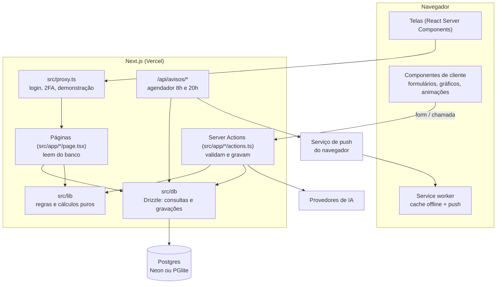
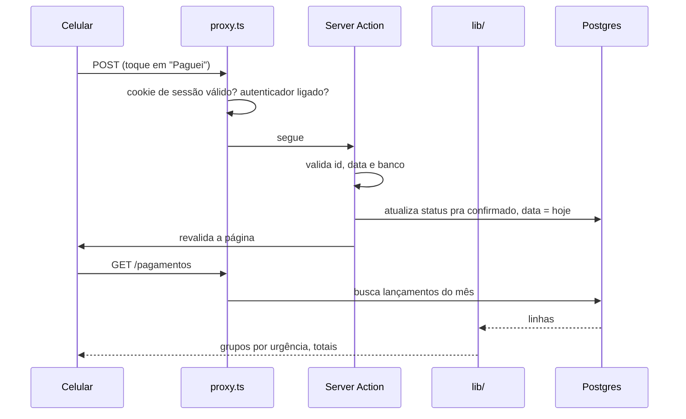
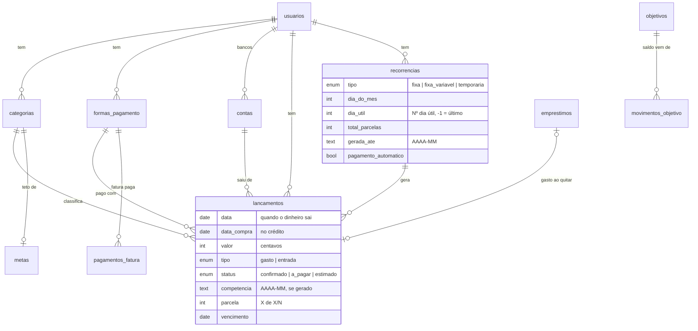

# Arquitetura

Como o ContaGasto é organizado por dentro e por que foi feito assim.

## Sumário

- [Visão geral](#visão-geral)
- [Stack](#stack)
- [Pastas](#pastas)
- [Caminho de uma requisição](#caminho-de-uma-requisição)
- [Três jeitos de rodar o banco](#três-jeitos-de-rodar-o-banco)
- [Modelo de dados](#modelo-de-dados)
- [Regras puras e testes](#regras-puras-e-testes)
- [Assistente com IA](#assistente-com-ia)
- [PWA, offline e notificações](#pwa-offline-e-notificações)
- [Design](#design)
- [Versões](#versões)

---

## Visão geral



A ideia central: **a tela não calcula nada.** Páginas buscam dados no banco, passam pras funções de `src/lib` e mostram o resultado. Gravações passam por Server Actions, que validam tudo de novo no servidor (o formulário do celular nunca é confiável).

## Stack

| Camada | Escolha | Por quê |
| --- | --- | --- |
| Framework | Next.js 16 (App Router), React 19 | Server Components mandam pouco JavaScript pro celular; Server Actions dispensam uma API REST separada |
| Linguagem | TypeScript estrito | Dinheiro e datas sem surpresa de tipo |
| Banco | PostgreSQL (Neon na nuvem, PGlite local) | Relacional, com índices únicos e `check` pra garantir regra no próprio banco |
| ORM | Drizzle | SQL tipado, migrations em SQL puro e versionadas, roda com Neon e PGlite |
| Estilo | Tailwind CSS 4, sem biblioteca de componentes | Controle total do visual mobile; tokens de cor validados |
| Gráficos | Recharts | Bom com React e acessível o suficiente com tabela de apoio |
| Animação | Motion (Framer Motion) | Micro-animações com respeito a "reduzir movimento" |
| Ícones | lucide-react | Uma família só, sem emoji na interface |
| Testes | Vitest | 33 arquivos, 419 testes, rodando em segundos |
| IA | SDK da Anthropic + fetch no formato da OpenAI | Troca de provedor por variável de ambiente |
| Push | web-push (VAPID) | Notificação sem app de loja |
| Planilha | ExcelJS | Exportar o ano em `.xlsx` |
| Deploy | Vercel + Neon | Migrations rodam sozinhas a cada deploy (`vercel-build`) |

## Pastas

```
src/
├── app/                     uma pasta por rota
│   ├── page.tsx             Início (painel do mês)
│   ├── lancamentos/         lista, novo, editar + actions.ts
│   ├── pagamentos/          contas do mês
│   ├── fixos/               fixos e parcelas
│   ├── metas/ objetivos/ emprestimos/ cartoes/
│   ├── graficos/ resumo/ relatorio/
│   ├── avisos/              avisos, lembretes, push
│   ├── assistente/          chat com IA
│   ├── conferir/            caça a erros e diferenças com o banco
│   ├── exportar/            Excel, backup, importar
│   ├── configuracoes/       categorias, formas de pagamento, bancos
│   ├── entrar/ seguranca/   login e autenticador
│   ├── dev/                 diagnóstico e logs (só o dono)
│   ├── demo/                ação "Restaurar exemplo" da demonstração
│   └── api/avisos/[vez]/    rota chamada pelo agendador
├── components/              49 componentes de interface
├── lib/                     regras de negócio puras (sem banco, sem tela)
│   ├── calculos.ts          sobrou, disponível, previsão
│   ├── recorrencias.ts      fixos, parcelas e fatura do cartão
│   ├── dias-uteis.ts        dia útil e feriados nacionais
│   ├── contas.ts            pagamentos e urgência
│   ├── importacao.ts        leitura e conciliação de extrato
│   ├── sessao.ts totp.ts    senha, sessão assinada e 2FA
│   ├── demo.ts              regras do modo demonstração
│   └── ia/                  formato neutro, provedores e adaptadores
├── db/
│   ├── schema.ts            tabelas, enums, índices e checks
│   ├── index.ts             conexão (Neon, PGlite ou demonstração)
│   ├── gerar-recorrencias.ts
│   ├── demo.ts              banco na memória com dados inventados
│   └── *.ts                 consultas por assunto
└── proxy.ts                 porteiro de todas as rotas
drizzle/                     16 migrations SQL + snapshots
scripts/                     migrar, seed, gerar ícones, testar conexão
public/                      ícones e service worker
docs/                        esta documentação
```

## Caminho de uma requisição

Exemplo: marcar uma conta como paga.



O `proxy.ts` roda antes de toda rota:

1. Rotas públicas (tela de entrar, ícones, manifesto, service worker) passam direto.
2. Sem sessão válida: página vai pro login; qualquer gravação recebe 401.
3. Com sessão mas sem autenticador ligado: só a tela Segurança abre.
4. No modo demonstração: tudo aberto, menos Dev, Segurança e o agendador.

## Três jeitos de rodar o banco

`src/db/index.ts` escolhe na primeira consulta:

| Situação | Banco | Pra quê |
| --- | --- | --- |
| Tem `DATABASE_URL` (ou `neon_DATABASE_URL`, `POSTGRES_URL`) | Neon (Postgres serverless) | Produção |
| Sem URL | PGlite salvo em `./.data/pglite` | Desenvolvimento no computador, sem instalar nada |
| `BOLSO_DEMO=1` | PGlite **só na memória** | Demonstração pública. Ignora qualquer URL configurada |

Os três falam o mesmo SQL pelo Drizzle, então o código das consultas é um só. Na Vercel sem URL o app para com erro em vez de usar disco local (o disco some a cada deploy e os dados se perderiam sem ninguém perceber).

### O banco da demonstração

`src/db/demo.ts` cria um PGlite na memória, aplica as mesmas migrations da pasta `drizzle/` e preenche com dados inventados **relativos à data de hoje**: quatro meses de salário, aluguel, contas, cartão, parcelas, metas, objetivos e empréstimos. Assim a demo sempre mostra o mês atual cheio de coisa acontecendo.

- As consultas esperam a montagem terminar antes de rodar (o cliente do banco é embrulhado por uma função que aguarda a promessa de "pronto").
- Depois de 30 minutos sem nenhuma requisição, o próximo acesso ganha um banco novo. Como a troca só acontece com o app parado, ninguém vê os dados mudarem no meio do uso.
- O botão **Restaurar** faz a troca na hora.

## Modelo de dados



Outras tabelas: `acesso` (hash da senha, segredo da sessão, 2FA, trava de tentativas), `lembretes`, `aparelhos_push`, `config_avisos`, `avisos_enviados` (anti-repetição), `conferencias_ignoradas` e `logs`.

Garantias no próprio banco:

- índice único `recorrencia_id + competencia (+ parcela)`: gerar fixos duas vezes nunca duplica;
- `check` de valor positivo, de subtipo só em entrada, de parcelas maior que zero em temporária;
- chaves estrangeiras com `set null` onde apagar um banco não pode apagar lançamentos.

## Regras puras e testes

Tudo que é regra mora em `src/lib`, em funções que recebem dados e devolvem dados. Nenhuma delas acessa banco, rede ou relógio por conta própria (a data de "hoje" entra como parâmetro). Isso deixa as regras fáceis de testar com casos difíceis: dia 31 em fevereiro, fatura que fecha no fim de semana, Sexta-feira Santa, parcela que atravessa o ano.

```bash
npm test
# Test Files  33 passed (33)
#      Tests  419 passed (419)
```

Os testes também cobrem a segurança (cookie adulterado, comparação em tempo constante, códigos 2FA repetidos, senha inicial recusada em produção) e o banco da demonstração (monta, gera os fixos e não deixa nada a pagar esquecido no passado).

## Assistente com IA

```
src/lib/ia/
├── tipos.ts       formato neutro: mensagens, ferramentas, resposta
├── config.ts      lista de provedores e leitura das variáveis
├── anthropic.ts   adaptador pelo SDK oficial
├── compativel.ts  adaptador no formato de chat da OpenAI (fetch puro)
└── index.ts       escolhe o adaptador
```

O app fala um formato próprio; cada adaptador traduz de e para o formato do provedor. Gemini, Groq e OpenRouter usam o adaptador compatível, então um provedor novo é só uma entrada em `config.ts`. Mais em [IA.md](IA.md).

## PWA, offline e notificações

- **Manifesto** em `src/app/manifest.ts`, com ícones normais e "maskable".
- **Service worker** próprio (`public/sw.js`): arquivos do build com cache primeiro; páginas com rede primeiro e, sem internet, a última versão vista ou a página "Sem internet". Nada que grava passa pelo cache.
- **Web Push**: chaves VAPID geradas e guardadas no banco na primeira vez. O agendador da Vercel chama `/api/avisos/manha` e `/api/avisos/noite`; a rota exige `CRON_SECRET` em produção e responde só contagens.

## Design

- **Mobile primeiro:** desenhado pra 390 px de largura, celular em pé. Barra de navegação embaixo, alvos de toque de 44 px no mínimo.
- **Paleta pastel**, com versões escuras pro tema escuro:

| Token | Claro | Uso |
| --- | --- | --- |
| fundo | `#FCEFFE` | fundo geral |
| lavanda | `#E0CFE8` | destaque, cabeçalhos |
| coral | `#FFAC81` | gastos, ações, alertas |
| limão | `#E8E691` | avisos, metas no limite |
| menta | `#8DFFDB` | positivo, entradas |
| tinta | `#3A2E3F` | texto |

- Pastel é só preenchimento. Texto e ícone em cima dele são sempre escuros (classe `sobre-pastel`).
- Nos gráficos, os mesmos tons mais escuros (coral `#D9622B`, menta `#1B8F6E`, lavanda `#7B4FA8`), conferidos pra contraste de 3:1 e daltonismo.
- **Modo escuro** segue o sistema ou a escolha em Mais (cookie, a página já chega no tema certo, sem piscar).
- **Animações** com propósito (número que conta, check ao salvar, barra enchendo) e paradas pra quem pede "reduzir movimento".
- Sem emoji na interface: só ícones.

## Versões

Versionamento semântico. A versão, o commit e a hora do build aparecem no rodapé da tela Mais, pra saber o que está no ar. Histórico em [CHANGELOG.md](../CHANGELOG.md).
