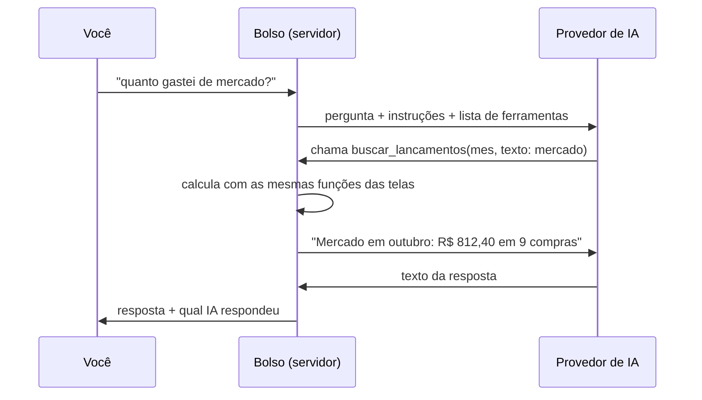

# Assistente com IA

O Assistente fica em **Mais, Assistente** e num cartão no topo do Início. Ele faz três coisas:

1. **Lança falando ou escrevendo:** "gastei 32 no almoço no pix" vira um cartão com valor, categoria, data, forma e banco. Você confere e toca em **Salvar**.
2. **Analisa o mês:** onde mais foi dinheiro, o que mudou desde o mês passado, metas estouradas, quanto dá pra gastar.
3. **Responde sobre o seu dinheiro:** "quanto gastei de mercado?", "quando cai o salário?", "o que vence essa semana?".

> Na **demonstração** a IA fica desligada, pra ninguém gastar a chave de ninguém. Pra usar, rode a sua cópia com a sua própria chave, como explicado abaixo.

## Sumário

- [Ligar com a sua chave (5 minutos)](#ligar-com-a-sua-chave-5-minutos)
- [Provedores](#provedores)
- [IA reserva](#ia-reserva)
- [Na Vercel](#na-vercel)
- [Como funciona por dentro](#como-funciona-por-dentro)
- [Privacidade](#privacidade)
- [Problemas comuns](#problemas-comuns)

---

## Ligar com a sua chave (5 minutos)

O jeito mais barato é o **Google Gemini**, que tem plano grátis.

1. Entre em [aistudio.google.com](https://aistudio.google.com), faça login com uma conta Google e clique em **Get API key**, depois em **Create API key**. Copie a chave.
2. Na pasta do projeto, crie um arquivo chamado `.env.local` (ele não vai pro Git) com:

   ```env
   IA_PROVEDOR=gemini
   GEMINI_API_KEY=cole-sua-chave-aqui
   ```

3. Rode o app:

   ```bash
   npm run dev
   ```

4. Abra `http://localhost:3000`, vá em **Mais, Assistente** e mande "analisa meu mês".

Pronto. O rodapé do Assistente mostra qual IA está respondendo.

## Provedores

Troca de provedor é só mudar variável de ambiente, sem mexer no código.

| `IA_PROVEDOR` | Onde pegar a chave | Variável da chave | Custo |
| --- | --- | --- | --- |
| `gemini` (padrão) | [aistudio.google.com](https://aistudio.google.com) | `GEMINI_API_KEY` | Grátis com limite por dia |
| `groq` | [console.groq.com](https://console.groq.com) | `GROQ_API_KEY` | Grátis com limite por dia |
| `openrouter` | [openrouter.ai](https://openrouter.ai) | `OPENROUTER_API_KEY` | Tem modelos grátis |
| `claude` | [console.anthropic.com](https://console.anthropic.com) | `ANTHROPIC_API_KEY` | Pago por uso (centavos por pergunta) |
| `compativel` | Qualquer IA no formato de chat da OpenAI | `IA_CHAVE` | Depende |

Ajustes opcionais, que valem pra IA principal:

```env
IA_MODELO=nome-do-modelo     # troca o modelo padrão do provedor
IA_URL=https://...           # troca o endereço (proxy, outra região, servidor local)
IA_CHAVE=...                 # uma chave só, pra qualquer provedor
```

Exemplo com uma IA rodando no seu computador (Ollama, LM Studio ou parecido):

```env
IA_PROVEDOR=compativel
IA_URL=http://localhost:11434/v1
IA_MODELO=llama3.1
IA_CHAVE=qualquer-coisa
```

O modelo precisa aceitar **chamada de ferramentas** (tool calling), senão ele não consegue buscar os números do app.

## IA reserva

Plano grátis acaba no meio do dia. Com uma reserva, quando a principal falha (limite, fora do ar, chave recusada), a mesma pergunta vai pra outra IA sozinha:

```env
IA_PROVEDOR=gemini
GEMINI_API_KEY=...
IA_RESERVA=groq
GROQ_API_KEY=...
```

A resposta da reserva aparece com a etiqueta "Respondido pela IA reserva". No topo do Assistente também dá pra escolher uma IA na mão, pra testar e comparar.

## Na Vercel

Cadastre as mesmas variáveis em **Settings, Environment Variables** do projeto e publique de novo. Nunca coloque chave no código nem no Git: o `.gitignore` já ignora todo arquivo `.env*` (menos o `.env.example`, que não tem valor nenhum).

## Como funciona por dentro



**O código calcula, a IA comenta.** A IA não faz conta: ela pede os números por ferramentas, e o app responde com valores já prontos e escritos em reais. As instruções proíbem somar ou inventar número.

| Ferramenta | O que devolve |
| --- | --- |
| `ver_mes` | Números do mês: entradas, gastos, sobra, categorias comparadas com o mês anterior, metas, objetivos e, no mês atual, disponível e previsão |
| `buscar_lancamentos` | Até 30 lançamentos de um mês, procurando por descrição, categoria, forma ou valor, com o total já somado |
| `ver_avisos` | Contas e entradas que vêm pela frente, com os dias contados |
| `simular_parcelamento` | Parcela e juros nas duas formas comuns de cobrar (Tabela Price e taxa aplicada uma vez) |
| `propor_lancamento` | **Não salva nada.** Monta o cartão pra você conferir |
| `propor_lembrete` | Idem, pra lembretes |

Limites pra gastar pouco: no máximo 3 idas e voltas de ferramenta por pergunta, só as últimas mensagens vão pra IA e o tamanho da resposta é limitado. A conversa fica só na aba do navegador.

O código está em `src/lib/ia/` (provedores e adaptadores), `src/lib/assistente.ts` (ferramentas e instruções) e `src/app/assistente/actions.ts` (o laço da conversa).

## Privacidade

O que vai pra IA são as perguntas e os números que as ferramentas devolvem (totais, descrições e valores de lançamentos que a pergunta pediu). Vale saber:

- No **plano grátis do Gemini**, o Google pode usar o que é enviado pra melhorar os produtos dele. Bom pra testar; com dado de verdade, prefira um plano pago que não use os dados pra treino.
- A 2.0 vai reduzir isso: ferramentas que só devolvem agregados e nomes trocados por apelidos antes de sair do aparelho. Veja o [roadmap](ROADMAP.md).

## Problemas comuns

| Mensagem | O que fazer |
| --- | --- |
| "O assistente ainda não está ligado: Falta a chave da IA" | Confira o nome da variável da chave (tabela acima) e reinicie o `npm run dev` |
| "IA_PROVEDOR tem um valor que não é o nome de uma IA" | Use só `gemini`, `groq`, `openrouter`, `claude` ou `compativel`. Chave vai na variável da chave, não aqui |
| "código 429" | Acabou o limite grátis do dia. Configure uma `IA_RESERVA` |
| "código 503" | O provedor está sobrecarregado. O app já tenta de novo uma vez sozinho |
| A IA responde mas não usa os números | O modelo escolhido não aceita ferramentas. Troque o `IA_MODELO` |
