# Manual de uso

Guia de cada tela do ContaGasto. As imagens são do modo demonstração, com dados inventados.

## Sumário

1. [Primeiros passos](#1-primeiros-passos)
2. [Início](#2-início)
3. [Lançar um gasto ou entrada](#3-lançar-um-gasto-ou-entrada)
4. [Lançamentos](#4-lançamentos)
5. [Pagamentos](#5-pagamentos)
6. [Fixos e parcelas](#6-fixos-e-parcelas)
7. [Cartões](#7-cartões)
8. [Metas](#8-metas)
9. [Objetivos](#9-objetivos)
10. [Empréstimos](#10-empréstimos)
11. [Avisos e lembretes](#11-avisos-e-lembretes)
12. [Gráficos e resumo do ano](#12-gráficos-e-resumo-do-ano)
13. [Assistente](#13-assistente)
14. [Conferir](#14-conferir)
15. [Exportar, importar e backup](#15-exportar-importar-e-backup)
16. [Categorias, formas de pagamento e bancos](#16-categorias-formas-de-pagamento-e-bancos)
17. [Segurança](#17-segurança)
18. [Instalar no celular](#18-instalar-no-celular)

---

## 1. Primeiros passos

Pra o ContaGasto calcular bem, vale fazer isto uma vez:

1. **Bancos:** em **Mais, Categorias, formas e bancos**, cadastre seus bancos e informe o saldo de hoje de cada um. Daí pra frente o app soma os lançamentos.
2. **Cartão:** em **Mais, Cartões**, informe o dia de fechamento e o de vencimento da fatura.
3. **Fixos:** em **Mais, Fixos e parcelas**, cadastre salário, aluguel, internet, assinaturas e compras parceladas que ainda estão correndo.
4. **Metas** (opcional): um teto de gasto pras categorias que mais pesam.

A barra de baixo leva pras telas do dia a dia: **Início, Lançamentos, Pagamentos, Metas e Mais**.

## 2. Início

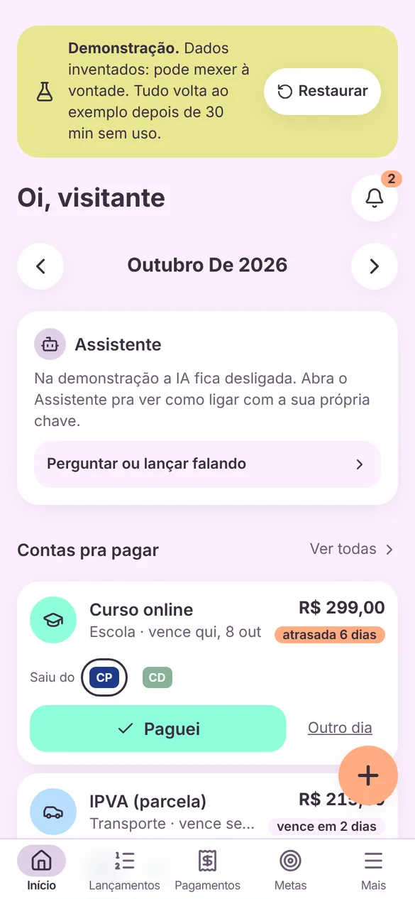

O painel do mês. De cima pra baixo:

- **Sino:** quantos avisos pedem atenção (ver [Avisos](#11-avisos-e-lembretes)).
- **Setas do mês:** volta pros meses anteriores. Disponível, previsão e linha do tempo aparecem só no mês atual.
- **Assistente:** comentários curtos sobre o mês, quando a IA está ligada.
- **Contas pra pagar:** atrasadas e as que vencem em até 3 dias, com **Paguei** a um toque.
- **Nas contas hoje:** quanto tem em cada banco. Toque pra abrir a lista.

<br clear="right" />

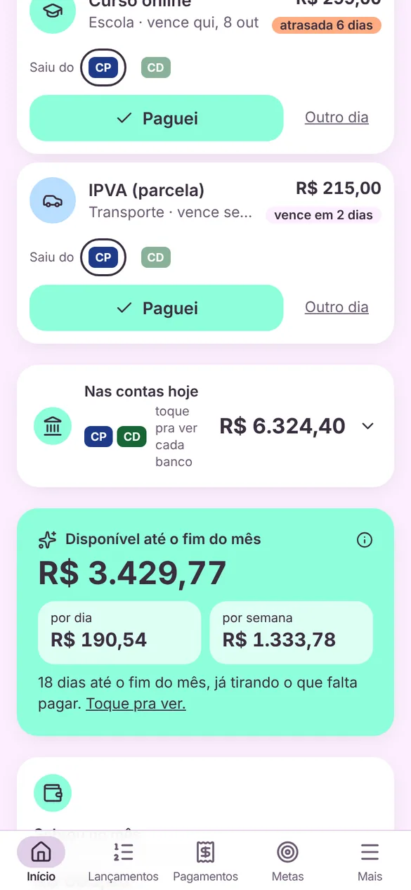

- **Disponível até o fim do mês:** o número mais importante do app. É o que dá pra gastar sem faltar pra nada que já está combinado, com o valor **por dia** e **por semana**. Toque no **i** pra ver a conta.
- **Sobrou no mês:** recebido menos gasto.
- **Recebido e Gasto** do mês.
- **Previsão no seu ritmo:** se continuar gastando como nos últimos 30 dias, o dinheiro dá até o fim do mês? Quanto sobra ou em que dia acaba.

<br clear="right" />

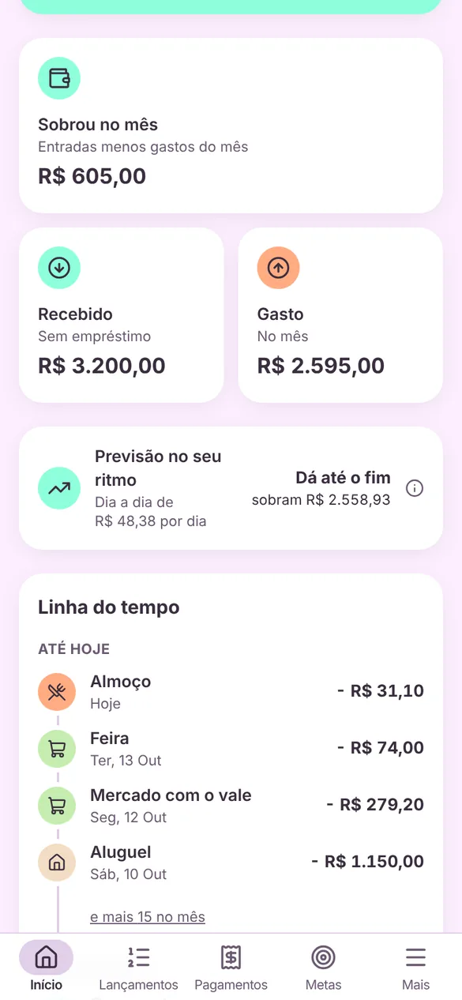

- **Linha do tempo:** o que já saiu, o que vai cair nos próximos dias (com etiquetas "a pagar", "estimado", "empréstimo") e como o mês fecha.
- Mais abaixo: **próximo mês já comprometido**, **assinaturas**, **empréstimos**, **metas pedindo atenção**, **guardado em objetivos** e **saldo do vale alimentação**.

O botão **+** laranja abre um lançamento novo. Ele some enquanto você rola pra baixo, pra não cobrir os valores.

<br clear="right" />

## 3. Lançar um gasto ou entrada

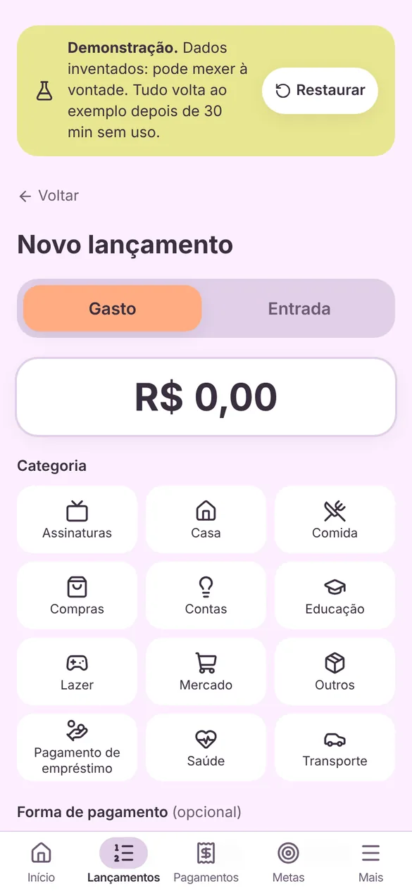

1. Toque no **+**.
2. Escolha **Gasto** ou **Entrada**.
3. Digite o **valor**.
4. Toque na **categoria** (cada uma tem um ícone).
5. Se quiser, ajuste **forma de pagamento**, **banco** (já vem o último usado), **data** e **descrição**. Sem descrição, o app usa o nome da categoria.
6. **Salvar.**

Opções que aparecem conforme a escolha:

- **Já paguei / Ainda vou pagar:** "ainda vou pagar" cria uma conta a pagar, que aparece em Pagamentos e não sai do saldo até você marcar Paguei.
- **Repetir:** todo mês (valor fixo), todo mês com valor que muda (luz, água) ou por N meses (parcelado).
- **Crédito:** a compra entra no mês em que a fatura vence. O app calcula sozinho pela data de fechamento.
- **Salário:** dá pra anotar bruto e descontos do holerite, só pra consulta. O que conta é o líquido.

<br clear="right" />

## 4. Lançamentos

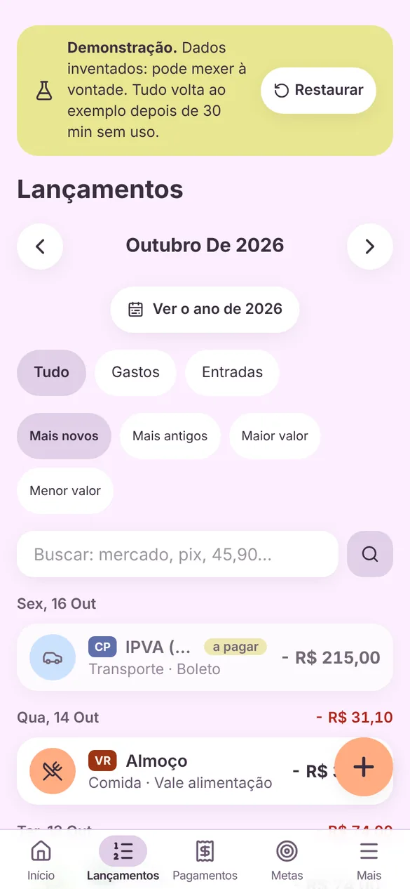

A lista do mês, agrupada por dia, com quanto entrou e saiu em cada dia.

- **Filtros:** tudo, gastos ou entradas.
- **Ordenar:** mais novos, mais antigos, maior ou menor valor.
- **Buscar:** por descrição, categoria, forma de pagamento ou valor ("mercado", "pix", "45,90"). Ignora acento.
- **Ver o ano:** a lista do ano inteiro.
- Toque num lançamento pra **editar**, **apagar** ou **virar fixo** (passa a repetir todo mês).

Cada lançamento mostra o selo do banco (sigla e cor) e etiquetas como "a pagar" e "estimado".

<br clear="right" />

## 5. Pagamentos

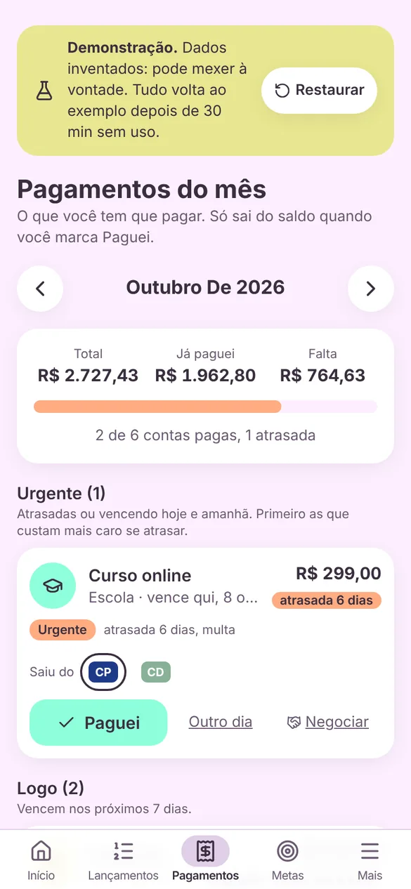

As contas do mês: o que já foi pago, o que falta e o que está atrasado.

- **Resumo:** total, já pago, falta e a barra de progresso.
- **Grupos por urgência:** Urgente (atrasada, hoje ou amanhã), Logo (até 7 dias), Com calma e Negociando. Dentro de cada grupo vem primeiro o que custa mais caro atrasar (cartão e aluguel antes de assinatura), com o motivo ("atrasada 6 dias, multa").
- **Paguei:** marca como paga hoje, descontando do banco escolhido. **Outro dia** pra informar outra data. Conta de valor variável pede quanto veio.
- **Negociar:** marque "Negociando" ou registre um acordo com data e valor novos.
- **Fatura do cartão** aparece como uma conta só.
- Conta não paga **continua aparecendo** nos meses seguintes até ser paga.

<br clear="right" />

## 6. Fixos e parcelas

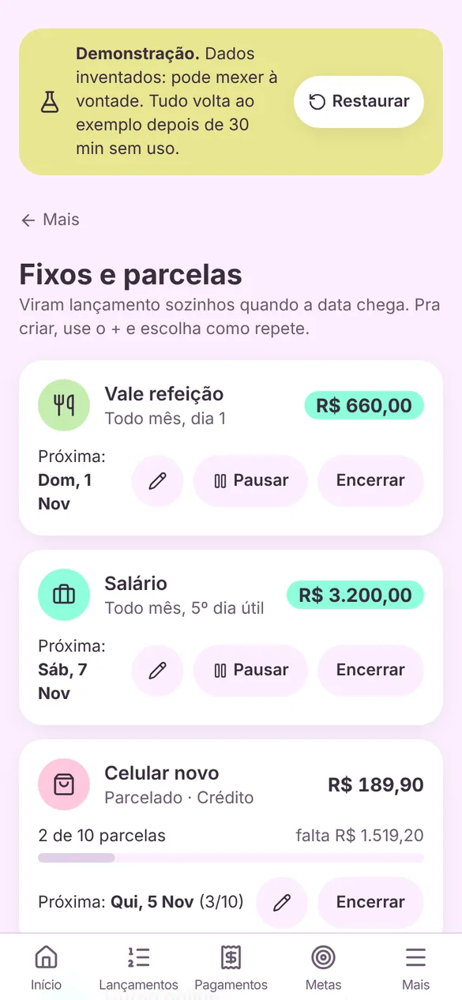

Tudo que repete. Viram lançamento sozinhos quando a data chega.

- **Tipos:** todo mês com valor fixo, todo mês com valor que muda (entra como estimado, pela média dos últimos 3 meses) e por N meses (parcela X/N).
- **Dia:** dia do mês, Nº dia útil (salário no 5º dia útil) ou último dia útil. Feriados nacionais são pulados.
- **Débito automático:** a conta já nasce paga.
- **Lápis:** edita tudo, com opção de aplicar nas contas que ainda estão a pagar.
- **Pausar / Retomar:** pausado não gera nada; ao retomar, não cobra os meses parados.
- **Encerrar:** para de repetir e mantém o histórico.
- **Apagar de vez:** escolhe se mantém o que já foi lançado (recomendado) ou apaga junto.

<br clear="right" />

## 7. Cartões

Em **Mais, Cartões**, informe o **dia de fechamento** e o **dia de vencimento** de cada cartão de crédito. Com isso:

- compra até o fechamento entra na fatura do mês; depois, na próxima;
- o gasto conta no mês do vencimento;
- nos Avisos aparece o **melhor dia de compra** (o dia seguinte ao fechamento, que dá mais tempo até pagar).

## 8. Metas

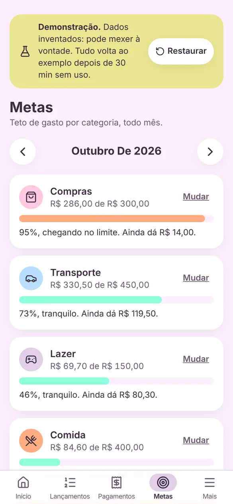

Teto de gasto por categoria, todo mês.

- Barra **verde** até 79%, **coral** de 80% até o limite, **vermelha** quando passa.
- Mostra quanto ainda dá ("Ainda dá R$ 80,30").
- **Mudar** troca o limite.
- Metas em atenção aparecem no Início e nos Avisos.

<br clear="right" />

## 9. Objetivos

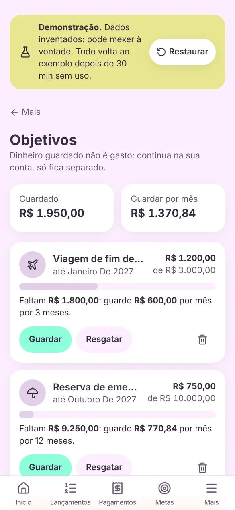

Caixinhas pra juntar dinheiro: nome, ícone, valor e data alvo.

- **Guardar** e **Resgatar** movimentam a caixinha. O dinheiro continua no banco, mas sai do disponível.
- Mostra quanto falta e **quanto guardar por mês** pra chegar na data.
- No topo, o total guardado e quanto guardar por mês somando todos.

<br clear="right" />

## 10. Empréstimos

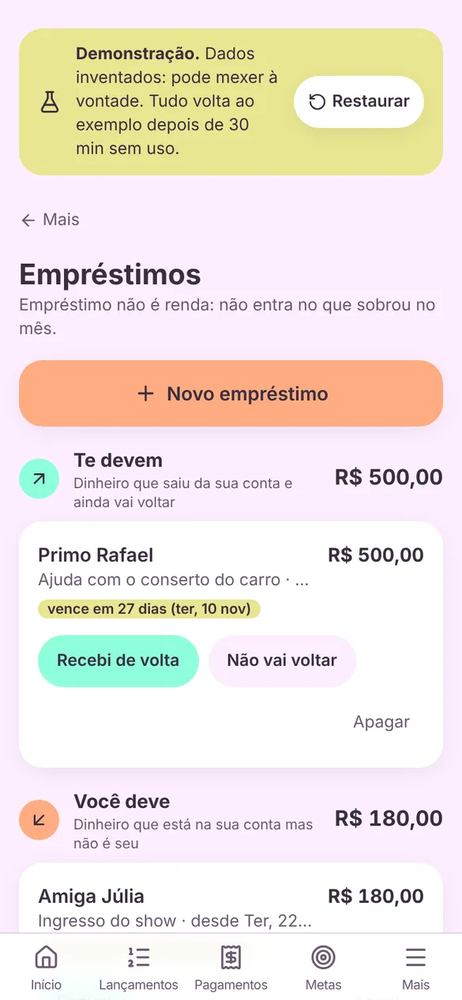

Quem te deve e a quem você deve. Empréstimo **não é renda**, por isso tem tela própria.

- **Novo empréstimo:** pessoa, valor, data, direção e prazo (opcional).
- **Te devem:** "Recebi de volta" quita; "Não vai voltar" vira gasto.
- **Você deve:** "Paguei" quita e o valor vira gasto em "Pagamento de empréstimo".
- **Reabrir** desfaz.

<br clear="right" />

## 11. Avisos e lembretes

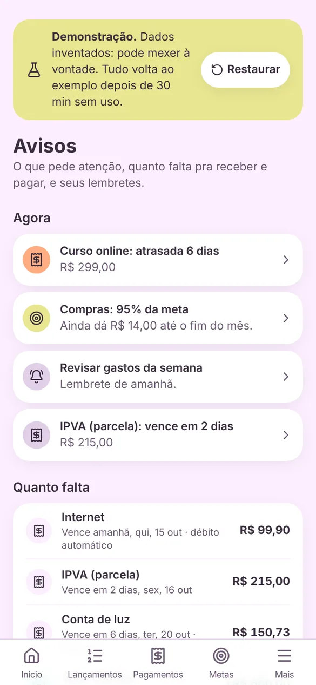

Abra pelo sino no Início ou em **Mais, Avisos e lembretes**.

- **Agora:** contas atrasadas ou vencendo, dia de receber, metas, empréstimos com prazo, ritmo do mês, melhor dia de compra, assinatura que renova amanhã.
- **Quanto falta:** dias até o salário, o vale e cada conta.
- **Lembretes:** "pagar o IPVA dia 15", uma vez ou repetindo. **Feito** marca como resolvido (o que repete pula pra próxima vez).
- **Notificações no celular:** ligue no aparelho e escolha o que receber. Chegam por volta das 8h e das 20h. No iPhone, só com o app instalado na tela de início.

<br clear="right" />

## 12. Gráficos e resumo do ano

<p>
  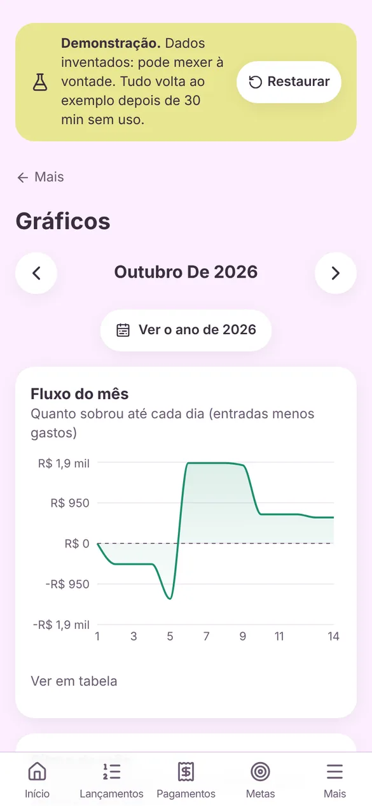
  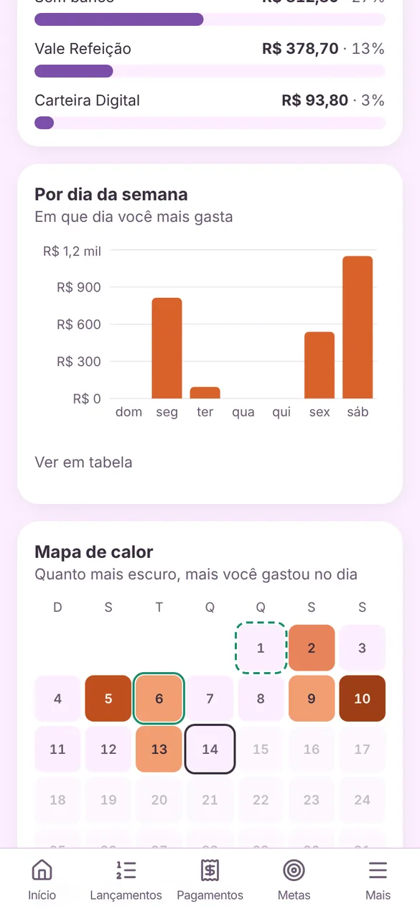
  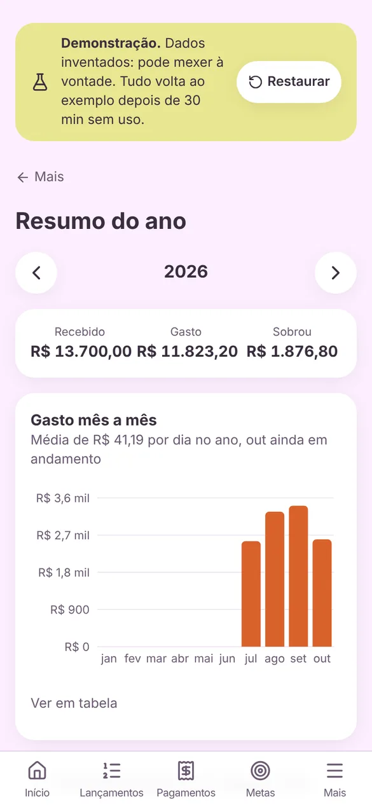
</p>

**Gráficos** (Mais, Gráficos), por mês:

- **Fluxo do mês:** quanto sobrou até cada dia.
- **Ritmo:** gasto acumulado comparado com o mês passado.
- **Maiores gastos**, **por forma de pagamento**, **por banco** e **por dia da semana**.
- **Mapa de calor:** quanto mais escuro, mais você gastou no dia. Marca os dias do salário e do vale.

Todo gráfico tem **Ver em tabela**, com os números exatos.

**Resumo do ano** (Mais, Resumo do ano): recebido, gasto e sobra do ano; gasto mês a mês; trimestre e semestre; as categorias onde mais foi dinheiro; e "o que dá pra notar" (mês mais caro, meses no vermelho, quinzena e dia da semana que mais pesam).

## 13. Assistente

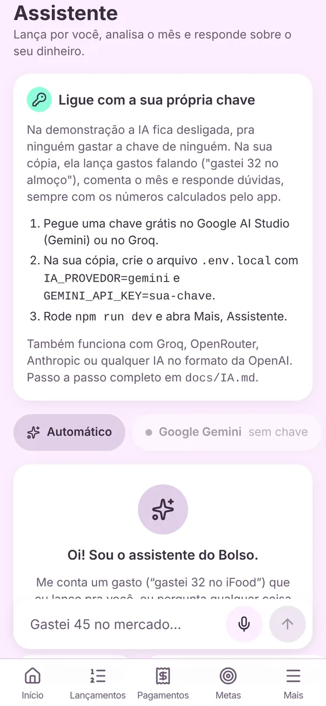

Um chat em **Mais, Assistente**:

- **Lançar falando:** "gastei 45 no mercado no débito" monta um cartão. Confira e toque em **Salvar**. Nada é salvo sem o seu toque.
- **Parcelado:** "parcelei um fone em 3x de 51,08".
- **Analisar:** "analisa meu mês", "o que mudou desde o mês passado?".
- **Perguntar:** "quanto gastei de mercado?", "quanto posso gastar por dia?", "quando cai o salário?".
- **Lembrar:** "me lembra de pagar o IPVA dia 15".
- O **microfone** usa o ditado do próprio celular.

Os números vêm das mesmas contas das telas; a IA só explica. Pra ligar com a sua chave, veja [IA.md](IA.md).

<br clear="right" />

## 14. Conferir

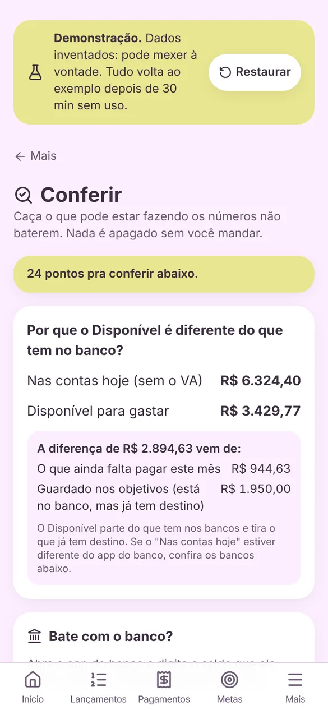

Em **Mais, Conferir**, o app procura o que pode fazer os números não baterem:

- por que o disponível é diferente do dinheiro no banco (com a conta explicada);
- cada banco comparado com o saldo que você digita do app do banco;
- contas atrasadas que talvez já foram pagas;
- possíveis lançamentos repetidos;
- lançamentos sem banco.

Nada é apagado sem você mandar. Dá pra ignorar um aviso que não é problema.

<br clear="right" />

## 15. Exportar, importar e backup

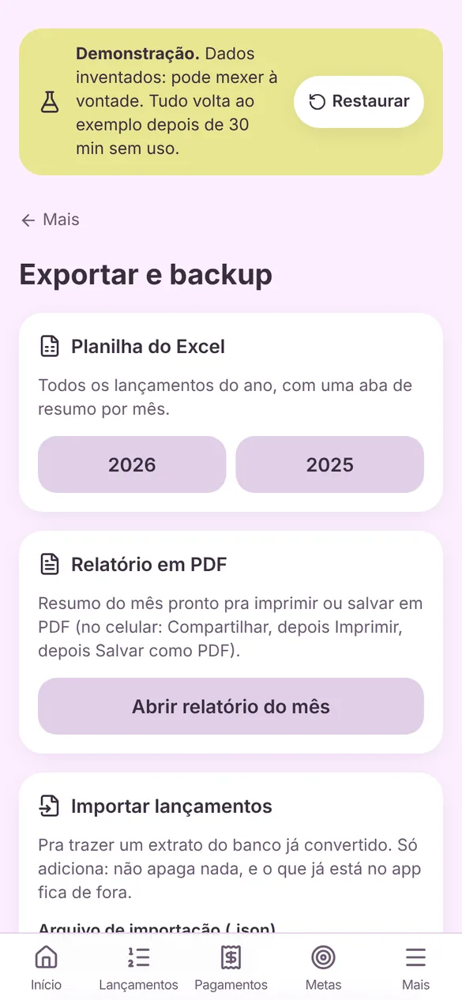

Em **Mais, Exportar e backup**:

- **Planilha do Excel** do ano: uma aba com os lançamentos e outra com o resumo por mês.
- **Relatório em PDF** do mês: abre uma página pronta pra imprimir; no celular, Compartilhar, Imprimir, Salvar como PDF.
- **Importar lançamentos** de um arquivo JSON (por exemplo, um extrato convertido). Só adiciona, nunca apaga, e não duplica: se você já lançou o mesmo gasto, o seu fica e ganha banco e descrição.
- **Arrumar duplicados:** acha o que ficou em dobro entre o que você lançou e o que veio do extrato, mostra a lista e apaga só depois de você confirmar.
- **Backup** de tudo num arquivo JSON e **Restaurar** (substitui tudo, pede RESTAURAR digitado).

<br clear="right" />

Formato do arquivo de importação:

```json
{
  "app": "bolso",
  "tipo": "importacao",
  "lancamentos": [
    {
      "data": "2026-10-03",
      "descricao": "Padaria",
      "valor": 1890,
      "tipo": "gasto",
      "categoria": "Comida",
      "forma": "Pix",
      "conta": "Conta Principal"
    }
  ]
}
```

`valor` em centavos. Categoria que não existe vira "Outros"; banco que não existe é criado.

## 16. Categorias, formas de pagamento e bancos

Em **Mais, Categorias, formas e bancos**:

- **Categorias:** criar, trocar ícone e cor, desativar (some dos formulários, o histórico fica).
- **Formas de pagamento:** Pix, débito, crédito, dinheiro, boleto, vale. Só dá pra apagar uma forma que nunca foi usada.
- **Bancos:** nome, sigla e cor do selo, e o **saldo de hoje**, que é a base do "Nas contas hoje" e do disponível.

## 17. Segurança

Na versão publicada:

- entrar pede **senha e o código do app autenticador** (Google Authenticator, Microsoft Authenticator, Authy);
- na primeira vez, a tela **Segurança** mostra um QR code pra ler no autenticador e **8 códigos de recuperação**. Guarde os códigos fora do celular;
- trocar a senha fica em **Mais**, e derruba os outros aparelhos;
- 5 erros seguidos travam o login por 15 minutos.

Detalhes técnicos em [SEGURANCA.md](SEGURANCA.md).

## 18. Instalar no celular

O ContaGasto é um PWA: dá pra instalar como app, sem loja.

- **Android (Chrome):** menu de três pontos, **Instalar app** ou **Adicionar à tela inicial**.
- **iPhone (Safari):** botão de compartilhar, **Adicionar à Tela de Início**.

Instalado, ele abre em tela cheia, recebe notificações e mostra as telas já vistas mesmo sem internet (lançar precisa de conexão).

**Tema:** em **Mais**, escolha Claro, Escuro ou seguir o sistema.

<p>
  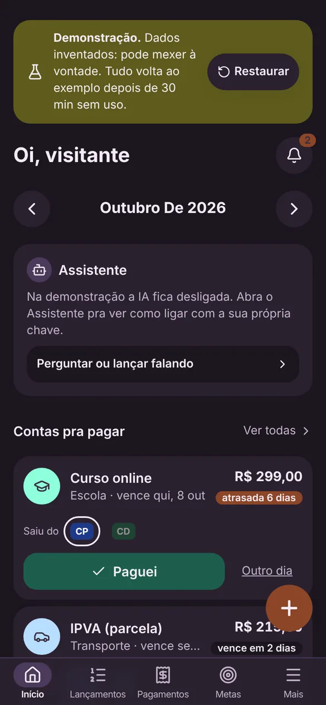
  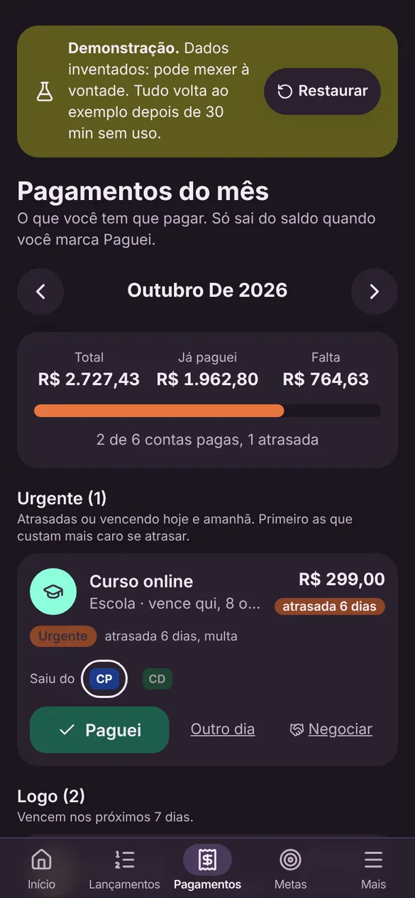
  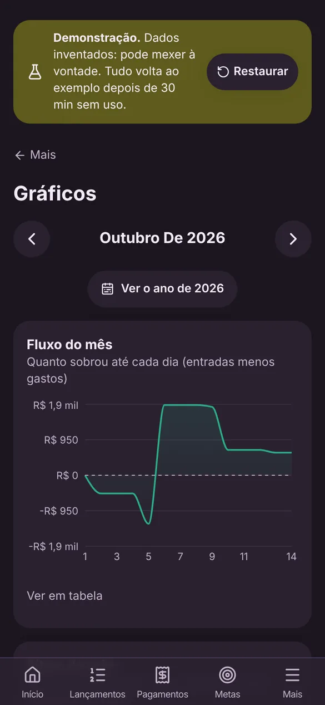
</p>
